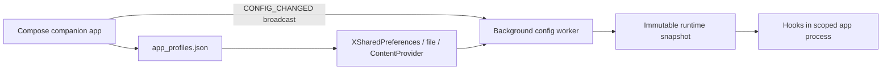

<div align="center">

# SpoofMyDevice

**Per-application Android device-profile spoofing for Xposed-compatible runtimes.**

[](https://github.com/bonelag/SpoofMyDevice/releases)
[](#requirements)
[](#requirements)
[](#build-from-source)
[](LICENSE)

SpoofMyDevice combines a Jetpack Compose profile manager with an Xposed module that applies selected device identities inside scoped application processes.

</div>

> [!WARNING]
> Use SpoofMyDevice only on devices and applications you own or are authorized to test. Patched or spoofed environments may violate application policies, trigger integrity controls, or cause data loss.

> [!IMPORTANT]
> Scope ordinary user applications only. Do not add Android System Framework, System UI, launchers, input methods, root managers, or other system-critical packages.

## Overview

SpoofMyDevice creates reusable Android device profiles, assigns them to individual applications, and exposes those profiles to hooks running inside each target process. Explicit assignments override the optional default profile; applications without either assignment retain real device values.

The project targets controlled compatibility testing, QA, privacy research, and development workflows. It does not modify the physical device globally.

## Capabilities

### Profile management

- Reusable remote presets and fully editable custom profiles
- 43 configurable preset examples with per-core CPU, RAM/DDR, storage, and graphics metadata
- Explicit per-application profile assignments
- Optional default profile for scoped applications without an explicit assignment
- Per-field controls and identifier randomization
- Live asynchronous configuration propagation to running target processes
- Import-compatible JSON preset format with configurable GitHub source

### Hook coverage

- `Build` and `Build.VERSION` fields
- Android, vendor, Java, and shell-visible system properties
- `getprop` and supported direct property-file reads
- Scoped readonly procfs/sysfs identity views, sensors, RAM/DDR metadata, and persistent shell readers
- Screen resolution, density, display metrics, and configuration
- CPU, SoC, ABI, hardware, OpenGL, GLSL, and Vulkan values
- Locale, timezone, user agent, and WebView behavior
- Telephony, SIM, baseband, GNSS, serial, and Android identifiers
- Advertising ID, App Set ID, and selected MediaDrm identifiers
- Package-manager and common emulator-detection surfaces

### Companion application

- Jetpack Compose interface with Material 3 Expressive and Miuix styles
- Miuix selected by default; interface style can be changed in Settings
- Dynamic system colors plus static color palettes
- English, Vietnamese, Korean, Japanese, and Simplified Chinese localization
- Profile editor, app assignment, Safe Mode, diagnostics, and real-device information screens
- Searchable preset picker with a bounded scrolling list and draggable scrollbar in both UI styles

## Architecture



Key runtime properties:

- `MainHook` is registered through `app/src/main/assets/xposed_init`.
- Profile state is persisted in the companion app's `app_profiles.json` file.
- Hook callbacks read in-memory profile data; configuration transport and virtual-file preparation run on the worker.
- File redirects use prepared indexes and compact inventory mappings. Completed, versioned virtual-file caches are reused across app processes; missing cache entries are restored with atomic file replacement. Ordinary native app/font/database paths bypass identity lookup work.
- A temporary transport failure preserves the last valid snapshot.
- A valid unassignment clears the active profile and restores captured `Build` values.
- Config reload requests are coalesced on a background worker.
- A validated primary application can prepare a direct-file startup cache before creation with a 100 ms wait limit. Full configuration transport starts on the worker after `Application.attach`; package class-loader callbacks do not start transport.
- Companion activation checks use the same primary-application, protected-process, and boot checks as target hooks.
- Active SDK properties are capped at the physical OS API while saved profiles retain their requested values. WebView/Chromium and supported native-library initializer guards use the physical SDK when the effective SDK differs from the OS SDK. Matching initial SDKs avoid global dispatch/class-loading hooks; installed guards return immediately when later settings match. User-agent callbacks are registered once per WebSettings implementation.
- Native hooks guard against tracing reentry and preserve bionic property handles and callback serials.
- Applications containing their own ShadowHook runtime use Java/shell compatibility: SpoofMyDevice skips its direct native backend to avoid two engines patching the same linker. Profiles and Java/shell hooks remain active; raw native reads can retain physical values. See [Shopee startup repair](docs/shopee-startup-fix-2026-11-14.md).

## Profile Resolution

| Priority | Condition | Result |
| --- | --- | --- |
| 1 | Target package has an explicit assignment | Apply assigned profile |
| 2 | No explicit assignment; default profile exists | Apply default profile |
| 3 | No assignment and no default profile | Preserve real device values |

Configuration updates are asynchronous. Force stop and relaunch a target application after changing its assignment when deterministic first-read behavior matters.

## Requirements

| Component | Requirement |
| --- | --- |
| Android | Android 8.0 / API 26 or newer |
| Primary runtime | Rooted device with LSPosed or another compatible Xposed runtime |
| Xposed metadata | Minimum API version 93 |
| Non-root workflow | LSPatch, NPatch, or another legacy-Xposed-compatible patch manager |
| Build environment | JDK 17 and Android SDK with API 37 |

Non-root compatibility depends on the patch manager and target application. Applications that validate signatures, installers, Play Integrity, or other environment signals may reject patched packages.

## Installation

### Rooted LSPosed

1. Install a trusted SpoofMyDevice APK and open it once.
2. Enable SpoofMyDevice in LSPosed.
3. Add only ordinary target applications to module scope.
4. Open **Profiles** and create or import a device profile.
5. Optionally mark one profile as the default.
6. Open **Apps** and assign overrides where needed.
7. Force stop and relaunch each newly assigned target application.

### Non-root patch managers

1. Install and open SpoofMyDevice once.
2. Register SpoofMyDevice as the Xposed module for the target APK in LSPatch, NPatch, or an equivalent tool.
3. Patch and install the target APK.
4. Create a profile, then set it as default or assign it directly to the patched package.
5. Relaunch the patched application.

Patched APK signatures differ from original signatures. Official updates replace patched installations, and signature-protected applications may stop working.

## Basic Workflow

1. Select a remote preset or start from the current device profile.
2. Edit identity, build, display, network, hardware, graphics, and advanced values as needed.
3. Save the profile.
4. Set a default profile or assign profiles per package.
5. Keep only intended user applications in Xposed scope.
6. Force stop and restart targets after changes.
7. Use **Diagnostics** to compare visible values inside the companion environment.

## Safe Mode

All active profiles cap the reported SDK/API at the physical OS API, preventing applications from selecting unavailable methods or fields. Safe Mode additionally preserves the remaining real Android-version metadata for selected packages:

- `Build.VERSION` fields
- `ro.*.build.version.*` properties

Other enabled profile fields—including model, fingerprint, hardware, telephony, network, and identifiers—continue to apply. Safe Mode also applies when the package receives its configuration from the default profile.

## Boot Safety

SpoofMyDevice reads fresh, original values for `sys.boot_completed` and `init.svc.bootanim` before initializing target-process hooks. Initialization proceeds only when boot is complete and boot animation reports `stopped`.

Additional safeguards:

- System UIDs, system applications, isolated/non-application UIDs, Zygote, and `system_server` are rejected.
- Android framework, System UI, launchers, input methods, root managers, and known critical vendor packages are protected.
- Runtime boot and power-state properties are never spoofed.
- Configuration transport runs outside hook callbacks.
- `getprop` output is rewritten as a stream while preserving process exit state, stdin, stderr, cancellation, and lifecycle operations.

Applications launched before boot readiness retain real values until their process is restarted.

### SMD Boot Guard

An optional KernelSU module is available at `ksu_module/smd_boot_guard` for devices affected by LSPosed soft-reboot black screens. It disables SpoofMyDevice in the LSPosed module database during `post-fs-data`.

Current Boot Guard behavior intentionally requires manual re-enabling after the home screen appears; `service.sh` does not auto-enable the module. Boot Guard is an optional recovery utility and is not required by the application runtime.

The earlier boot-safe APK passed three KernelSU soft reboots on iQOO V2507A / Android API 35 / KernelSU v3.3.1 / LSPosed 2.2.1 with profiles reporting API 35, 36, and 37. SpoofMyDevice stayed enabled and Boot Guard was absent. Later device investigation identified a native tracing deadlock and newer-SDK API-selection crashes. Version 2.0.6 includes native recursion/serial repairs and SDK compatibility guards; the combined version still requires renewed on-device startup, System Extra, and soft-reboot validation. See [Device Validation](docs/boot-safety-validation-2026-11-06.md), [Identity Coverage Repair](docs/identity-coverage-fix-2026-11-06.md), and [Boot Hang Investigation](docs/boot-hang-investigation.md).

## Preset Sources

The app reads JSON presets from a configurable GitHub repository and caches successful responses locally. A source may point to a repository root or a `presets` directory.

Example:

```json
{
  "id": "pixel_8_pro",
  "brandLabel": "Google",
  "modelLabel": "Pixel 8 Pro",
  "summary": "Tensor G3 - Android 15",
  "profile": {
    "brand": "google",
    "manufacturer": "Google",
    "model": "Pixel 8 Pro"
  }
}
```

See [Preset Format](presets/README.md) and the repository's [`presets`](presets) directory for complete examples.

## Permissions and Data Handling

| Permission | Purpose |
| --- | --- |
| `INTERNET` | Refresh JSON presets from the configured GitHub source |
| `QUERY_ALL_PACKAGES` | Display installed applications for profile assignment and Safe Mode selection |
| `READ_PHONE_STATE` / `READ_PHONE_NUMBERS` | Read available real-device telephony values for diagnostics and current-device profiles |
| `com.google.android.gms.permission.AD_ID` | Read available advertising-ID information for diagnostics/profile tooling |

Profiles and assignments are stored locally. Source inspection shows direct network access only for preset retrieval through the GitHub contents API; no telemetry backend is configured.

## Build From Source

### Prerequisites

- JDK 17
- Android SDK with API 37
- Android NDK 27.0.12077973 and CMake 3.22.1
- Git

### Clone and build

```bash
git clone https://github.com/bonelag/SpoofMyDevice.git
cd SpoofMyDevice
./gradlew :app:assembleDebug
```

Windows PowerShell:

```powershell
git clone https://github.com/bonelag/SpoofMyDevice.git
Set-Location SpoofMyDevice
.\gradlew.bat :app:assembleDebug
```

Generated APK:

```text
app/build/outputs/apk/debug/app-debug.apk
```

### Tests and static analysis

```bash
./gradlew :app:testDebugUnitTest :app:lintDebug
```

The repository uses Gradle 9.5.0, Android Gradle Plugin 9.3.0, Kotlin Compose plugin 2.3.21, Java 17, and a local compile-only Xposed API JAR.

The GitHub Actions workflow is manual and publishes a debug-signed APK. It reads `versionName` from the generated APK metadata to name the release and its `v<versionName>` tag; no version input is needed. Configure a private release keystore before distributing production builds.

## Verification Status

| Check | Last recorded result |
| --- | --- |
| JVM unit tests | 87 passed across 19 suites; 0 failures/errors/skips |
| Preset catalog/config/identity validation | 43 passed on the host JVM; original nine preset hashes preserved |
| Current `compileDebugKotlin` | Passed |
| Current `assembleDebug` | Passed |
| Current `lintDebug` | Passed with 0 errors and 121 warnings |
| Native packaging | ARM64/ARMv7 hooks and x86/x86_64 fallback stubs built successfully |
| Native host regressions | Path semantics/allocation fast paths and tracing reentry/callback/thread/exception guard checks passed |
| KernelSU soft reboot on V2507A | Earlier boot-safe APK: 3 passed with API 35/36/37 profiles; combined 2.0.6 repairs need renewed device validation |

## Repository Layout

```text
app/
  src/main/cpp/ Native identity hooks and unsupported-ABI stubs
  src/main/java/com/devicespooflab/hooks/
    data/       Profile storage, preset loading, and settings
    hooks/      Xposed hook groups
    ui/         Material and Miuix Compose interfaces
    utils/      Runtime configuration, safety policy, and process rewriting
docs/           Investigation and validation notes
ksu_module/     Optional SMD Boot Guard KernelSU module
presets/        Community-maintained JSON device profiles
.github/        Manual build-and-release workflow
```

## Known Limitations

- Device identity is not changed globally; only supported APIs inside eligible scoped processes are affected.
- Unsupported native/raw-syscall paths, hardware-backed attestation, Play Integrity, and server-side risk systems can still reveal the real environment. Native hooks support ARM64/ARMv7; other packaged ABIs use Java fallback.
- Targets with a host-owned ShadowHook runtime use Java/shell compatibility and do not receive direct native identity hooks.
- Default component and kernel metadata are synthetic profile values. Exact factory component identities require verified metadata.
- Applications may cache identifiers before asynchronous profile loading completes.
- Processes started during boot need a restart after boot readiness.
- Vendor ROM behavior varies. Test on a recoverable device configuration and keep a rollback path.
- Current release artifacts are debug-signed unless rebuilt with a private release key.

## License and Responsible Use

Source code is distributed under the [MIT License](LICENSE) with an additional responsible-use disclaimer. Users remain responsible for authorization, legal compliance, application policies, and all consequences of use.

## Acknowledgements

- Original DeviceSpoofLab Hooks project
- Xposed and LSPosed communities
- Jetpack Compose, Material 3, MaterialKolor, and Miuix projects
